# Hey, I'm Root 👋

  

  </a>
  
  

---

## 👨‍💻 About Me

I'm a software developer passionate about programming, technology, and building useful digital solutions.

I enjoy developing backend systems, modern web applications, Minecraft server tools, and Discord integrations. I'm always exploring new technologies, learning through hands-on experience, and improving my development skills.

- 💻 Backend & Full-Stack Development
- ⚙️ APIs, automation & system architecture
- 🎮 Minecraft server development
- 🤖 Discord bots & integrations
- 🚀 Continuous learning and innovation

---

## 🚀 My Projects

<table>
  <tr>
    <td align="center" width="50%">
      <h3>🛡️ SecurityX</h3>
      

        An advanced network management and global ban management platform designed for Minecraft servers.
      

      

        
      

      

        
      

    </td>
    <td align="center" width="50%">
      <h3>💻 Imperior Development</h3>
      

        A development initiative focused on software projects, custom solutions, and digital products.
      

      

        
      

    </td>
  </tr>
</table>

---

---

## 🧰 Tech Stack

### Programming Languages

  

### Web Development

  

### Databases, Infrastructure & Tools

  

---

## 📊 GitHub Statistics

  
  

---

## 🤝 Connect With Me

  <a href="https://discord.com/users/381816029426221057">Discord</a> ·
  <a href="https://www.instagram.com/alexclient/">Instagram</a>

  <i>Learn. Build. Improve. Repeat.</i>

